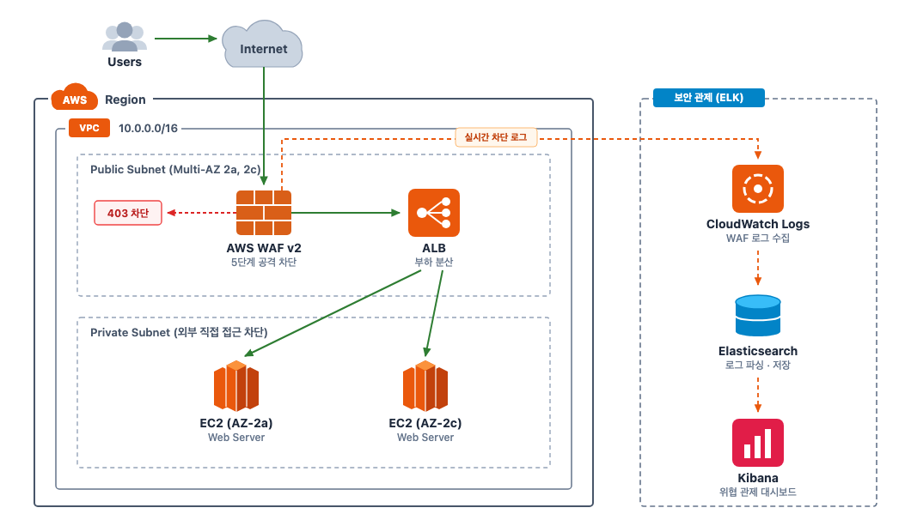
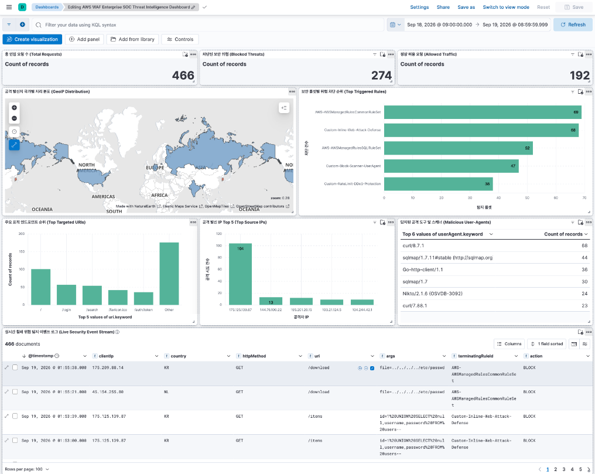

# AWS WAF & ELK Real-Time Web Security Pipeline

Terraform으로 구축한 Multi-AZ 웹 인프라에 AWS WAF v2 5단계 차단 정책을 적용하고, CloudWatch Logs와 Elasticsearch, Kibana를 연동하여 실시간 보안 관제 체계를 구현한 프로젝트입니다.

---

## Architecture

인터넷 트래픽이 Multi-AZ ALB로 도달하기 전 AWS WAF v2에서 5단계 규칙으로 검사하여 악성 요청을 사전 차단합니다. 차단 및 허용 로그는 CloudWatch Logs를 거쳐 Python 수집기로 Elasticsearch에 실시간 색인되며, Kibana 관제 화면에서 공격 현황을 시각화합니다. 백엔드 웹 서버는 보안 그룹(Security Group)으로 외부 직접 접근을 차단하고 ALB 경유 트래픽만 허용합니다.



---

## Key Implementations

### 1. Multi-AZ 웹 인프라 (Terraform)
- `ap-northeast-2a`, `ap-northeast-2c` 2개 가용 영역에 Public/Private 서브넷, ALB, Nginx 웹 서버 배포
- 보안 그룹 체인 설계를 통해 백엔드 인스턴스로의 80/443 외부 직접 접근을 차단하고 ALB를 경유한 인입만 허용

### 2. 5단계 WAF 차단 정책 (Web ACL)
검사 효율과 보안성을 고려해 처리 우선순위(Priority)에 따라 규칙을 계층형으로 배치했습니다.
1. **Custom Inline SQLi & XSS Defense** (`priority = 5`): URL Decode 및 Lowercase 정규화를 적용해 파라미터 변조 및 스크립트 삽입 즉시 차단
2. **AWS Managed Common Rule Set** (`priority = 10`): Path Traversal, LFI/RFI 등 알려진 웹 취약점 패턴 방어
3. **AWS Managed SQLi Rule Set** (`priority = 20`): 심층 DB 인젝션 시그니처 2차 방어
4. **Custom Scanner & Bot Defense** (`priority = 30`): `sqlmap`, `nikto` 등 악성 자동화 취약점 점검 도구 차단
5. **Custom Rate Limiting** (`priority = 40`): 동일 IP에서 5분간 100회 초과 요청 시 차단하여 L7 DDoS 및 무차별 대입 완화

### 3. 서버 정보 은폐 (Custom 403 Response)
- 차단 응답 시 웹 서버 종류나 버전(Nginx 등)이 드러나지 않도록 커스텀 403 화면 분리 적용
- 불필요한 시스템 정보를 은폐하고 고유 차단 코드(`sec-waf-block`)만 반환하여 공격자의 정찰(Fingerprinting) 차단

### 4. 실시간 로그 파이프라인 및 Kibana 관제
- CloudWatch Logs(`aws-waf-logs-sec-pipeline`)의 WAF 차단 이벤트를 Python 수집기(`scripts/sync_cloudwatch_waf_to_es.py`)로 파싱 및 GeoIP 매핑 후 Elasticsearch에 실시간 적재
- Kibana 대시보드를 통해 공격 국가 분포(GeoIP), 주요 표적 URI, 공격자 IP Top 5, 실시간 차단 로그 테이블 시각화 (466건 공격 데이터 검증)



---

## Verification Scenarios

| 점검 항목 | 공격 유형 및 페이로드 | 대응 룰셋 | 판정 |
| :--- | :--- | :--- | :---: |
| **정상 서비스 접속 및 오탐 검증** (`TC-01`) | `GET /search?q=C%2B%2B&lang=ko` (정상 파라미터 및 특수문자 인입) | Default Action | **200 OK (허용)** |
| **SQL Injection (우회 시도)** (`TC-02`) | `' UNION SELECT NULL, version()--`, URL 인코딩(`%27`) 변조 | Custom Inline SQLi (URL Decode 정규화) | **403 Forbidden (차단)** |
| **Reflected XSS (난독화 대응)** (`TC-03`) | ``, 대소문자 혼합(`sCrIpt`) 삽입 | Custom Inline XSS (Lowercase 변환) | **403 Forbidden (차단)** |
| **시스템 파일 침투 (LFI/Path Traversal)** (`TC-04`) | `../../../../etc/passwd`, 널 바이트(`%00`) 삽입 우회 | AWS Core Managed Rule (CRS) | **403 Forbidden (차단)** |
| **자동화 스캐너 및 무단 크롤링** (`TC-05`) | `User-Agent: sqlmap`, `Nikto`, `python-requests` 헤더 변조 | Custom Scanner & Bot Rule | **403 Forbidden (차단)** |
| **L7 DDoS 및 무차별 대입 방어** (`TC-06`) | 동일 IP에서 5분간 100회 초과 고빈도 요청 인입 | Custom Rate Limit Rule | **403 Forbidden (차단)** |

---

## Directory Structure

```text
aws-waf-elk-pipeline/
├── terraform/                   # Terraform 인프라 코드
│   ├── alb.tf                   # Application Load Balancer 및 리스너/타겟그룹
│   ├── ec2.tf                   # Multi-AZ Nginx 백엔드 인스턴스
│   ├── security.tf              # 보안 그룹 체인 설정
│   ├── vpc.tf                   # Multi-AZ VPC 및 서브넷/인터넷게이트웨이
│   ├── waf.tf                   # AWS WAF v2 웹 ACL 및 5단계 차단 룰셋
│   ├── outputs.tf               # ALB DNS 등 출력 변수
│   └── templates/
│       ├── user_data.sh.tpl     # Nginx 초기 구성 템플릿
│       └── waf_403.html         # 커스텀 403 차단 응답 화면
├── scripts/                     # 자동화 및 파이프라인 스크립트
│   ├── attack_simulator.sh      # 6종 공격 시나리오 자동 시뮬레이션
│   ├── sync_cloudwatch_waf_to_es.py  # CloudWatch -> Elasticsearch 로그 수집기
│   ├── setup_soc_dashboard.py   # Kibana 대시보드 자동 프로비저닝
│   └── optimize_soc_dashboard.py # 대시보드 메트릭 최적화
├── data/                        # 테스트용 WAF 차단 로그 데이터셋
├── docker-compose.yml           # 로컬 Elasticsearch & Kibana 구동 환경
├── docs/                        # 프로젝트 문서 및 증적 캡처
│   └── screenshots/             # 아키텍처 및 Kibana 대시보드 캡처
└── .gitignore                   # 민감 정보 및 Terraform 상태 파일 차단
```

---

## Getting Started

### 1. 인프라 배포 (Terraform)
```bash
cd terraform
cp terraform.tfvars.example terraform.tfvars
terraform init
terraform apply
```

### 2. 관제 스택 실행 (Docker Compose)
```bash
docker-compose up -d
# Elasticsearch: http://localhost:9200
# Kibana: http://localhost:5601
```

### 3. 공격 시뮬레이션 및 로그 수집
```bash
# ALB DNS로 6종 시나리오 트래픽 인입
./scripts/attack_simulator.sh <ALB_DNS_NAME>

# CloudWatch WAF 로그를 Elasticsearch로 동기화
python3 scripts/sync_cloudwatch_waf_to_es.py
```

### 4. 리소스 정리 (Teardown)
```bash
cd terraform
terraform destroy
docker-compose down -v
```
